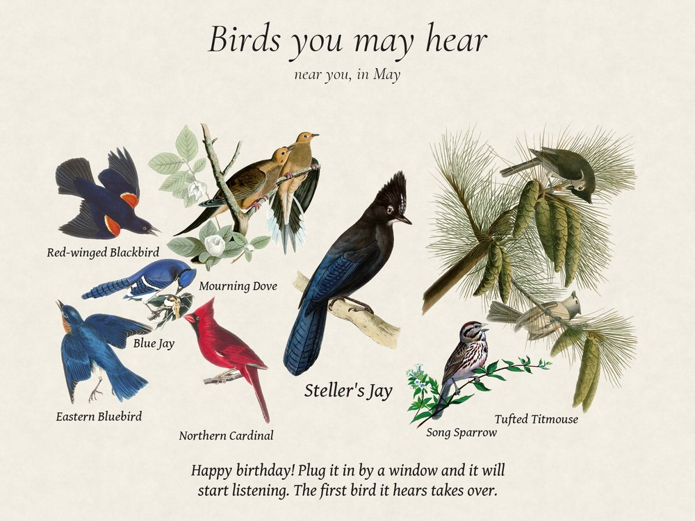

# Giving it as a gift

A frame can go in the box with a picture on it: the birds the recipient may hear where they live, in the month it arrives, with your note at the bottom. E-ink keeps the picture without power, so it is there when the box is opened.



Wrapping also gets the frame ready for its new home. It forgets the birds heard at your place, sets the recipient's location in BirdNET-Go and can save their Wi-Fi, so it starts listening as soon as it is plugged in.

It needs a frame with an Inky panel and the BirdNET-Go that the [install](install.md) sets up beside it.

## Wrapping it

Do this last, once the frame works: install it, check the panel and the microphone, and let it hear a few birds.

Then, over SSH on the Pi:

```bash
cd ~/fugleramme
uv run fugleramme-gift
```

Fill in the form. Each line gets a green ✓ when you leave it, or a red ✗ with what is wrong.

| Field | What to put |
| --- | --- |
| Place | Where the frame is going: a town or an address, or `latitude, longitude` |
| Arrives | The day it arrives, as `YYYY-MM-DD`. The birds are the ones likely there that month |
| Note | Up to three lines for the bottom of the picture. A line too long for this frame's panel says by how many characters |
| Favourites | Birds that must be on the picture, separated by commas. The first is drawn large in the middle. A misspelt name gets a suggestion |
| Wi-Fi name and password | Optional. The recipient's network, so the frame joins it by itself |
| Admin | Shown when the admin page has a password. Tick it to clear the password for the new owner |

The keys are along the bottom of the screen:

- **Tab** and **Shift-Tab** move between fields.
- **Ctrl-P** draws the picture on the frame, to see how it looks. A full refresh can take 30 seconds. Nothing else changes.
- **Ctrl-W** wraps it. Press it twice: the first press says what will happen.
- **Esc** quits without wrapping, and the frame goes back to its birds.

Wrapping stops BirdNET-Go, sets aside the birds it heard at your place, writes the new location into its settings, and saves the Wi-Fi and clears the password if you asked. The frame then draws the picture one last time and says when it is done:

```text
Wrapped. Unplug it now. The splash stays without power.
Don't plug it in again before it's given: the first boot opens it.
```

Unplug it and box it.

## Changed your mind

Before you unplug it, this puts everything back as it was: your birds, the location, the Wi-Fi and the admin password.

```bash
uv run fugleramme-gift unwrap
```

After it has been unplugged and started again, there is nothing to undo: it has been opened.

## When it is opened

The first time the frame starts after wrapping, gift mode is over. BirdNET-Go starts listening at the new place, the birds set aside from your place are deleted, and the picture gives way to a bare branch until the first birds it hears there.

If it has no Wi-Fi it knows, it opens its own [Wi-Fi setup](wifi.md) as any frame does.

> [!NOTE]
> Plugging it in again at home, even for a quick test, counts as opening it. To wrap it again, run `uv run fugleramme-gift` again.

## When it isn't available

- A frame reading another BirdNET-Go, or BirdWeather stations, cannot be wrapped: the birds and the location are not its own to change.
- A frame without an Inky panel has nothing to hold the picture without power. The command says so.
