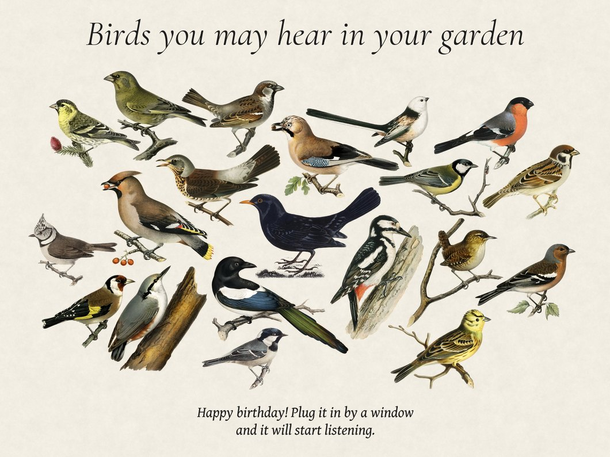

# Giving it as a gift

E-inks keep the drawn frame without power, which makes for a great opportunity to leave a nice surprise for the recipients of the frame!

Gift-wrap the frame before you give it away, and it shows a nice picture when the box is opened: birds that are common where the recipient lives (or whichever you'd like to show), and a custom title and message from you.



Wrapping also gets the frame ready for its new owner. It sets the location and timezone, and you can delete your old detections, wipe your saved Wi-Fi networks and remove the admin password.

> [!IMPORTANT]
> Only meant to work on an all-in-one build: a Pi with Fugleramme installed and an Inky panel connected.

A frame that uses BirdWeather, or connects to BirdNET-Go on another machine, can be wrapped too. (Since it doesn't listen for birds itself, there's no location to set and no detections to delete)

## Before you wrap

- Check that everything works: the panel, and BirdNET-Go (if installed). Make sure that it actually draws something on the screen when hearing a bird sound.
- Set the display settings in the admin the way the recipient should have them: language, label font, artwork, rotation and margins. The gift picture uses these settings, and the frame keeps them afterwards.
- Remove anything personal you set in BirdNET-Go's own settings (e.g a BirdWeather token).

## Wrapping

Run this over SSH on the Pi:

```bash
cd ~/fugleramme
uv run fugleramme-gift
```

The frame's web server shuts down while the command runs (so it won't be reachable), and start again if you quit. `sudo` may ask for your password.

It will ask four things:

| Question | Answer |
| --- | --- |
| Location | Where the recipient lives: a town, an address, or `latitude, longitude`. The command shows the place and timezone it found, so you can check them |
| Birds on the picture | `1` uses the most common birds near the location this month: 20 of them, or any number from 0 to 40. `2` lets you choose them: type an English or scientific name, pick from the list, and leave a line empty to finish |
| Message | Up to three lines, shown at the bottom of the picture. Leave a line empty to skip/finish |
| Title | Shown at the top of the picture, with the default text "Birds you may hear in your garden" |

> [!NOTE]
> The most common birds are the ones most often seen within 50 km of the location this month, according to [GBIF](https://www.gbif.org). (Birds without artwork are skipped)

> [!IMPORTANT]
> The picture is then drawn on the panel, which takes up to 30 seconds. Enter a number to change an answer, `w` to wrap or `q` to quit. Nothing on the frame is changed until you wrap.

Wrapping asks up to three more questions:

| Question | Answer |
| --- | --- |
| Delete this frame's detections and audio clips? | Only asked on a frame with its own BirdNET-Go. Type `delete` to delete them. This can't be undone, so back up BirdNET-Go first if you want a copy. Press Enter to keep them |
| Forget saved Wi-Fi networks? | Yes by default. Your networks and their passwords are removed, and the frame starts [Wi-Fi setup](wifi.md) the next time it's plugged in |
| Remove the admin password? | Only asked if one is set. Yes by default, because the recipient can't change settings without it |

The command then lists everything wrapping will do and asks you to confirm. After that the frame shuts down. Wait 30 seconds, then unplug it. Unplugging it right away is also fine.

If your SSH connection drops before you wrap, nothing is changed. Reboot the frame to get its page back.

## After wrapping

When the frame is plugged in again, it starts up as usual. The gift picture is replaced by the birds it hears, or an empty branch until it hears the first one. If it has no Wi-Fi network, it starts [Wi-Fi setup](wifi.md).

> [!NOTE]
> This also happens if you plug it in again at home. Run `uv run fugleramme-gift` again to wrap it again.

Changed your mind? Run the command again with your own location to set the frame back. Deleted detections can't be restored.

## What is not changed

- The Pi's hostname. The frame's address is still the `<host>.local` you set it up with.
- BirdNET-Go's own settings, apart from the location.
- The admin settings, apart from the password.
