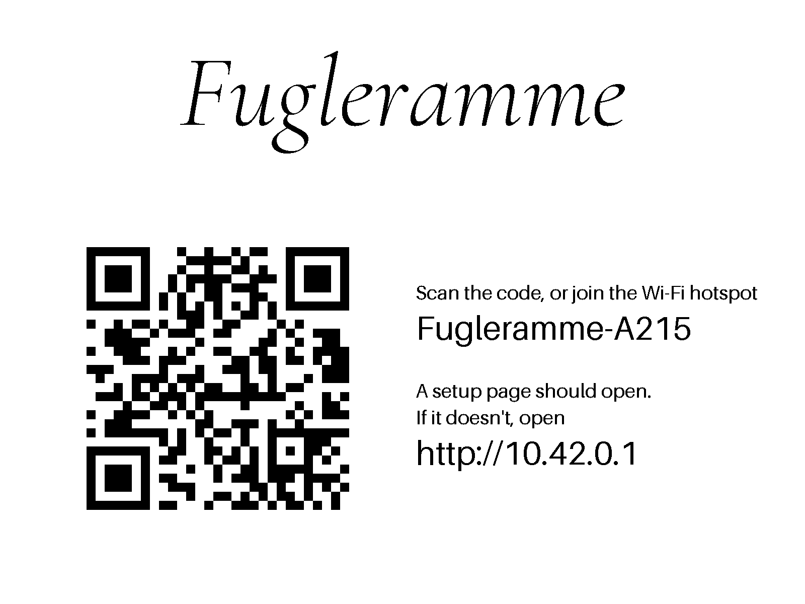
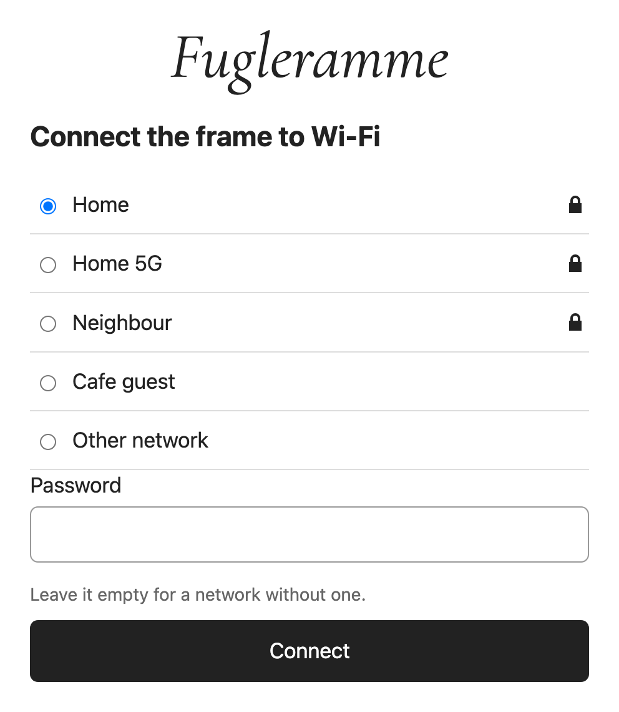
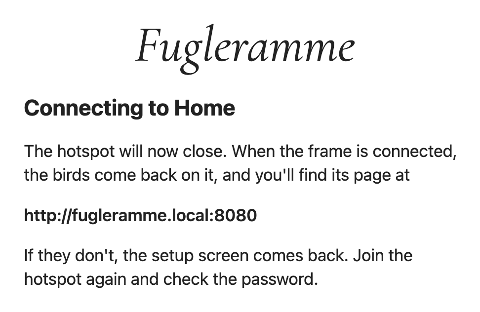
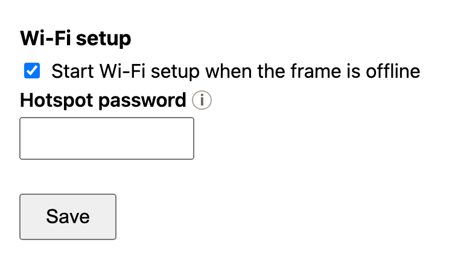

# Wi-Fi

A frame with an Inky panel can be moved to a new Wi-Fi network without SSH.
When it starts up without a network, it will open a Wi-Fi hotspot of its own and show you how to connect.

## Setting up



1. Plug the frame in. If it's unable to connect to a network, the setup screen appears. (can be turned off - on by default)
2. Scan the QR code on the screen with your phone's camera, or join the hotspot (name on screen),
   `Fugleramme-` and four characters.
3. A setup portal will open by itself. If it doesn't, open `http://10.42.0.1` (also on the screen) in a browser.
4. Pick your network, or **Other network** for a hidden one, type its password and press **Connect**.

| Pick your network | Connecting |
| :---: | :---: |
|  |  |

Networks with a password (WPA Personal) or totally open are supported. Enterprise networks are not.

The hotspot closes and the frame will join the Wi-Fi. When the birds come back on the display, it worked,
and the frame's page is at `http://<host>.local:8080`. If the setup screen comes back
with *Couldn't join <network>*, join the hotspot again and check the password.

Gifting the frame to someone? Set it up on your own network as usual. In its new home it should begin the setup after a few minutes and these steps are all the new owner needs.

> [!NOTE]
> The setup page is tested on iPhone. It should open the same way on Android - if it
> doesn't, please [open an issue](https://github.com/arnegiacomo/fugleramme/issues) (I didn't know anyone who could test this for me).

## Changing network

Hold button **A** for five seconds. The setup screen and hotspot will come up while you're still holding it. Hold **A** again to close it without changing anything and it reconnects to a network it knows.

The frame remembers the networks it already has connected to.

## Hotspot password

The hotspot is open by default: while it is up, anyone nearby can join it and pick
a new Wi-Fi for the frame. You can configure a password by setting **Hotspot password** (8 to 63
characters) under **Wi-Fi setup** on the admin page's System tab. The setup screen shows the password, and the QR code carries it.



## Turning it off

Untick **Start Wi-Fi setup when the frame is offline** on the System tab. Holding **A** then does nothing. And the hotspot won't automatically open if the frame can't connect to a network.

## When it isn't available

- Only a Pi with an Inky panel connected has this - not HDMI, an external panel or the container.
- The frame needs permission to change the network. If the System tab says it isn't allowed, run the command it shows on the Pi. That is the [install command](install.md#3-install-the-frame), which is safe to rerun.

## Over USB-C (gadget mode)

The other way to move the frame to a new network, or onto one you can't reach it over yet.

> [!IMPORTANT]
> Will only be possible if gadget mode has been enabled.

```bash
ssh <user>@10.12.194.1 # or <user>@<host>.local if you've enabled internet sharing on your computer
nmcli device wifi list
sudo nmcli --ask device wifi connect "<SSID>"
```
